# Bloom Hackathon Kit

**하루 만에 만들고, 그 자리에서 VC가 심사하는 해커톤**을 누구나 똑같이 열 수 있게 공개하는 운영 키트예요.

2026년 10월 24일, [Bloom](https://bloomworld.ai/community/)이 Anthropic과 함께 서울 AI 허브에서 연 원데이 해커톤 **Ambition for Korea**에서 실제로 쓴 코드예요. 참가자 제출, VC 실시간 심사, 현장 LED, 운영 콘솔, 샤크탱크 매칭, 디스코드 AI 운영까지 하루를 굴린 시스템을 그대로 담았어요.

[](https://vercel.com/new/clone?repository-url=https%3A%2F%2Fgithub.com%2Fpatrickhan-coder%2Fbloom-hackathon-kit&project-name=bloom-hackathon&repository-name=bloom-hackathon&env=ADMIN_KEY&envDescription=%EC%9A%B4%EC%98%81%20%EC%BD%98%EC%86%94%20%EB%B9%84%EB%B0%80%EB%B2%88%ED%98%B8%EC%98%88%EC%9A%94.%20VC%20%EC%8B%AC%EC%82%AC%20%EB%A7%81%ED%81%AC%EB%8F%84%20%EC%9D%B4%20%EA%B0%92%EC%9C%BC%EB%A1%9C%20%EB%A7%8C%EB%93%A4%EC%96%B4%EC%A0%B8%EC%9A%94.&envLink=https%3A%2F%2Fgithub.com%2Fpatrickhan-coder%2Fbloom-hackathon-kit%2Fblob%2Fmain%2F.env.example&products=%5B%7B%22type%22%3A%22integration%22%2C%22protocol%22%3A%22storage%22%2C%22productSlug%22%3A%22upstash-kv%22%2C%22integrationSlug%22%3A%22upstash%22%7D%2C%7B%22type%22%3A%22blob%22%2C%22access%22%3A%22public%22%7D%5D)

버튼을 누르면 웹사이트, Redis 데이터베이스, 발표자료 저장소가 한 번에 만들어져요. 정할 것은 운영 콘솔 비밀번호 하나예요. 자세한 건 [배포](#배포)를 보세요.

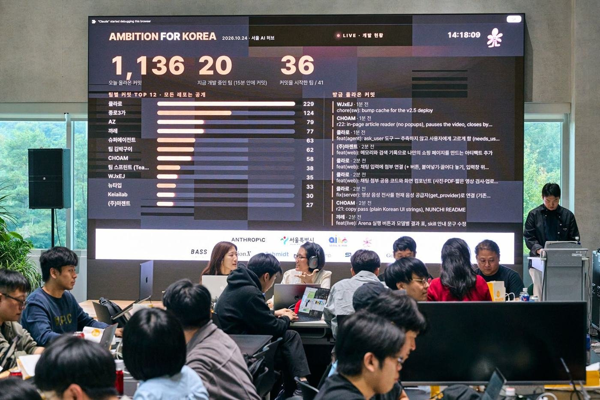

## 그날 숫자

| 960명 신청 | 105명 · 41팀 | GitHub 커밋 2,812회 | 제출 36팀 | VC 판단 121표 | 본선 8팀 | 후속 미팅 5팀 |
|---|---|---|---|---|---|---|

운영 쪽 숫자도 있어요.
- 판정 28건은 모두 투표 그대로 자동으로 나왔고, 운영진이 손으로 바꾼 건 0건이에요.
- 참가자 질문 65건에 AI가 먼저 답했고, 첫 답까지 중앙값은 31초예요. 디스코드 봇 게시물은 모두 288개예요.
- 5분마다 자동 백업을 271번 했어요.

## 어떤 해커톤인가

해커톤은 보통 만드는 데서 끝나요. 이 해커톤은 만든 것을 그날 바로 투자자 앞에 세우고, **"이 팀과 다음 미팅을 하고 싶은가"**로 끝나게 설계했어요.

- **VC가 심사위원이자 출제자예요.** VC 여섯 곳이 미션을 직접 내고, 제출이 들어오는 즉시 각자 노트북으로 데모를 써 보고 판단해요.
- **공정함은 사람이 아니라 시스템이 지켜요.** 당일 코드만 쓰게 하고, 제출은 한 번, 결과는 먼저 3표가 모인 쪽으로 자동으로 정해져요.
- **속도와 완성도 사이에서 팀이 직접 고민해요.** 먼저 낼수록 먼저 심사받지만, 덜 된 채 냈다가 탈락하면 끝이에요. 본선 8자리가 차는 순간 문이 닫혀요.
- **운영은 AI에게 맡겼어요.** 참가자 질문 응대, 공지, 결과 발표를 AI와 스크립트가 맡고, 운영진은 판단이 필요한 일만 했어요.

## 하루는 이렇게 흘러가요

실제 Ambition for Korea 기준이에요.

| 시각 | 무엇이 일어나나 |
|---|---|
| 09:00 | 오프닝. 서울시 개회사, Anthropic 파이어사이드 |
| 09:40 | 무대에서 VC 미션 9개를 한 장씩 공개해요. 그 순간 참가자 페이지에서 주제 선언이 열려요 |
| 10:00 | 빌드 시작. 모든 팀의 커밋이 LED에 실시간으로 올라가요 |
| 11:10 | 주제 선언 마감. 10:30에서 세 번 연장했고, 41팀 중 36팀이 선언했어요 |
| 14:34 | 첫 제출. VC 여섯 곳의 실시간 심사가 시작돼요 |
| 15:51 | 첫 결과. 16:05에 첫 본선 진출이 나왔어요 |
| 17:00 | 제출 마감. 36팀이 냈어요 (16:36부터 25분 동안 17팀이 몰렸어요) |
| 17:36 | 본선 8팀 확정. 자리가 차서 남은 8팀은 심사를 받지 못했어요 |
| 19:00 | 샤크탱크. 팀당 발표 3분(영어), 질의응답 7분(한국어). 만나고 싶은 VC가 손을 들어요 |
| 20:45 | 최종 매칭. 본선 8팀 중 5팀이 VC와 후속 미팅을 잡았어요 |
| 그날 밤 | VC 한 줄 평 114개를 VC 이름 없이 아카이브로 공개 |

| 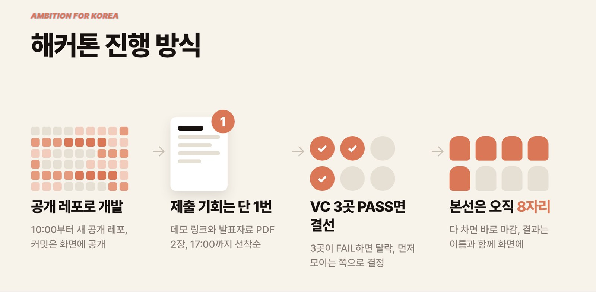 | 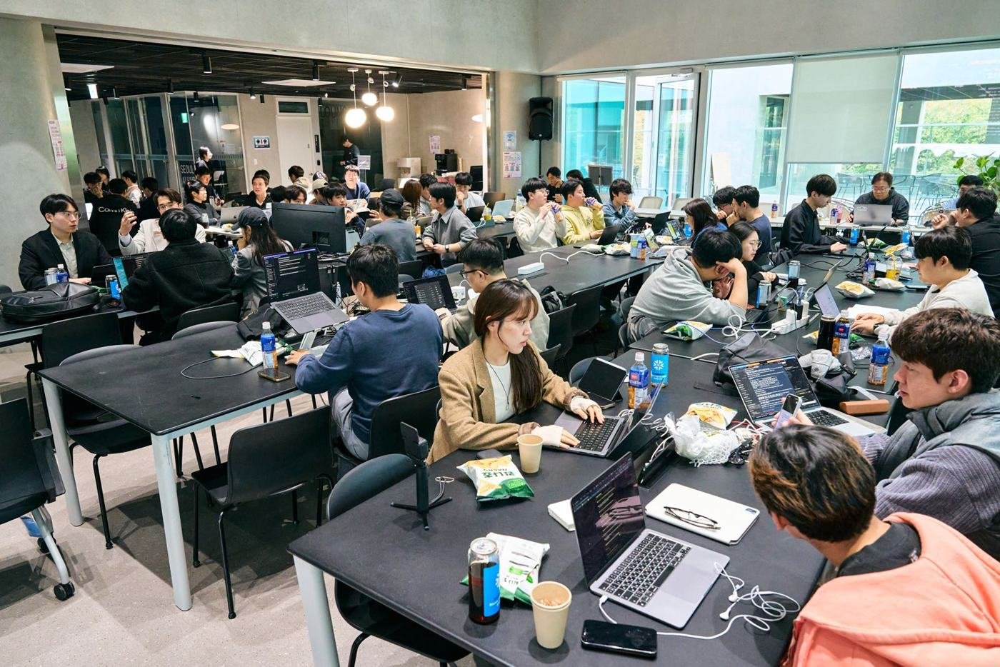 |
|---|---|
| 오프닝에서 보여 준 진행 방식 | 41팀이 하루 동안 만든 현장 |

## 규칙 한눈에

- **같은 자원**: 참가자 한 명당 Claude 크레딧 $500. AI 기능은 Claude로만 만들어요. 디자인·영상 같은 주변 도구는 자유지만 비용은 각자 부담이에요. 팀은 2~4명.
- **당일 코드만**: 10:00 이후 새로 만든 공개 레포에서만 개발하고 main에 push해요. 모든 커밋이 LED에 공개되고, 10시 전 커밋, 3,000줄이 넘는 첫 커밋, 과거 이력은 VC 심사 화면에 경고로 떠요. 오픈소스는 포크하지 말고 새 레포에 가져와 출처를 적어요. 기존 코드를 썼다면 제출할 때 직접 표시해요.
- **VC가 낸 미션**: 미션 9개 중 하나, 또는 와일드카드(우리 팀 아이디어, 타깃 해외 시장 필수)를 골라요. 선언한 뒤에는 바꿀 수 없어요.
- **제출은 팀당 한 번**: 서비스 이름, 한 줄 소개, 데모 링크, VC가 먼저 볼 데모 사용법, 발표자료 PDF 2장. 제출하는 순간의 커밋으로 심사해요.
- **먼저 3표**: PASS 3표가 먼저 모이면 본선, FAIL 3표가 먼저 모이면 탈락이에요. 확정된 뒤에 들어오는 표는 받지 않아서 3:3은 생기지 않아요.
- **순서를 지키는 장치**
  - VC는 아직 결과가 안 난 팀 중 제출이 빠른 3팀까지만 판단할 수 있어요. 결정 전까지는 낸 판단을 고칠 수 있어요.
  - 탈락은 결정되는 즉시 발표돼요. 본선은 제출 순서대로 발표돼요. 뒤 팀이 먼저 3표를 받아도 앞 팀 결과가 나올 때까지 LED에서 "발표 대기"로 기다려요.
- **본선 8자리**: 자리가 차는 순간 심사가 끝나요. 그 뒤에 낸 팀은 결과를 받지 못해요.
- **한 줄 평은 이름 없이**: VC가 남긴 한 줄 평은 VC 이름 없이 공개되고, 메모는 운영진만 봐요.
- **패자부활(대비책)**: 마감 뒤 자리가 남으면 PASS를 1표 이상 받은 탈락 팀을 PASS가 많은 순, 같으면 먼저 낸 순으로 올려요. 그날은 정규 심사로 8자리가 다 차서 쓰지 않았어요.
- **샤크탱크**: 본선에 오른 순서대로 발표 3분(영어)과 질의응답 7분(한국어)을 해요. 끝나면 VC가 '만나고 싶어요'나 '패스'를 누르고, 손 든 VC가 LED에 한꺼번에 떠요. 여러 곳이면 팀이 고르고, 한 VC가 여러 팀과 매칭될 수 있어요.

| 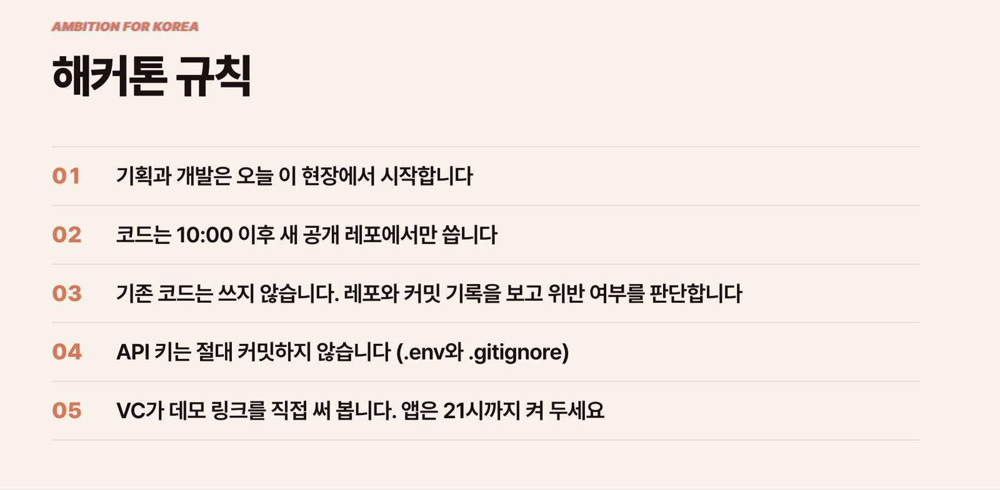 |  |
|---|---|
| 참가자에게 보여 준 규칙 다섯 줄 | VC가 보는 기준은 하나 |

규칙의 이유와 당일에 바뀐 것(마감 연장, 자동 발표 전환, 매칭 방식 변경 등)은 [docs/rules.md](docs/rules.md)에 시각과 함께 정리했어요.

## 화면으로 보는 하루

실제 행사 화면이에요. 참가자와 팀원 이름은 가렸어요.

| | |
|---|---|
| 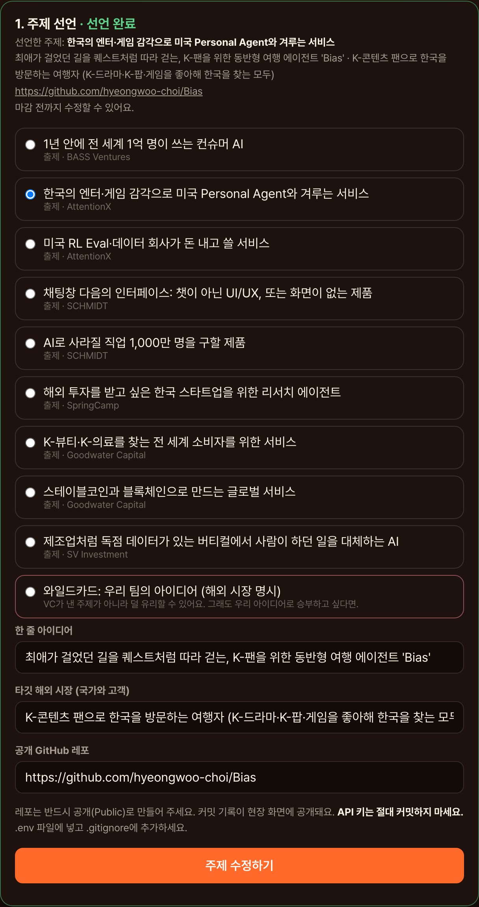 | 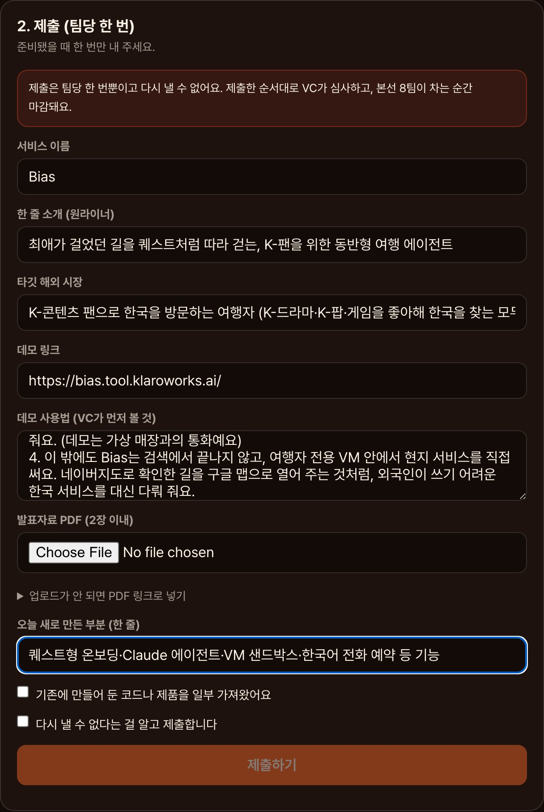 |
| **주제 선언**: 미션 9개와 와일드카드 중 하나, 아이디어, 타깃 해외 시장, 공개 레포 | **제출(팀당 한 번)**: 데모 링크, VC가 먼저 볼 데모 사용법, 발표자료, 기존 코드 사용 여부 |
| 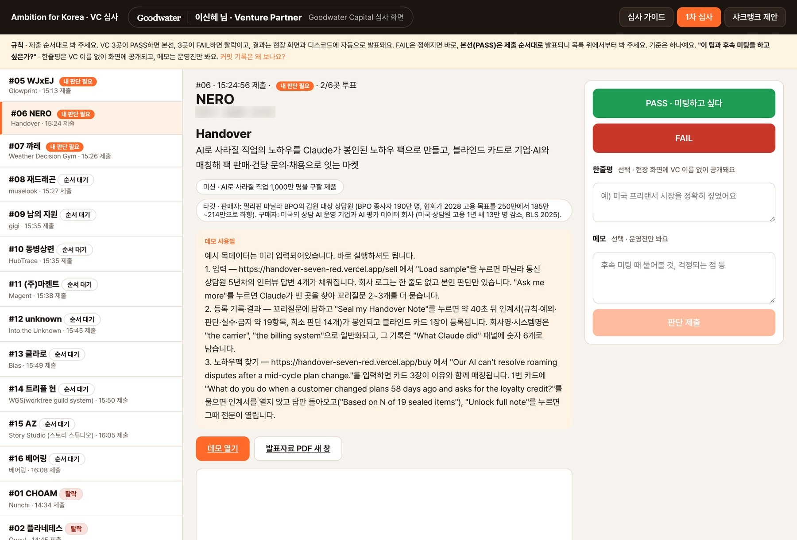 | 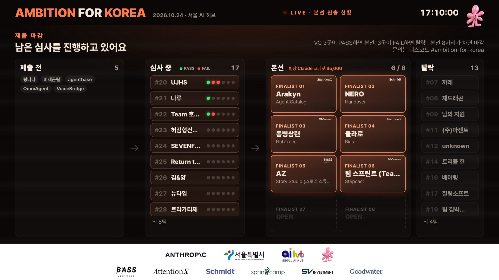 |
| **VC 심사**: 제출 순서대로 데모·발표자료·커밋 기록을 보고 PASS·FAIL, 한 줄 평, 메모 | **LED 실시간 보드**: 제출 전 → 심사 중(VC 표가 초록·빨강 점으로) → 본선 8자리 → 탈락 |
| 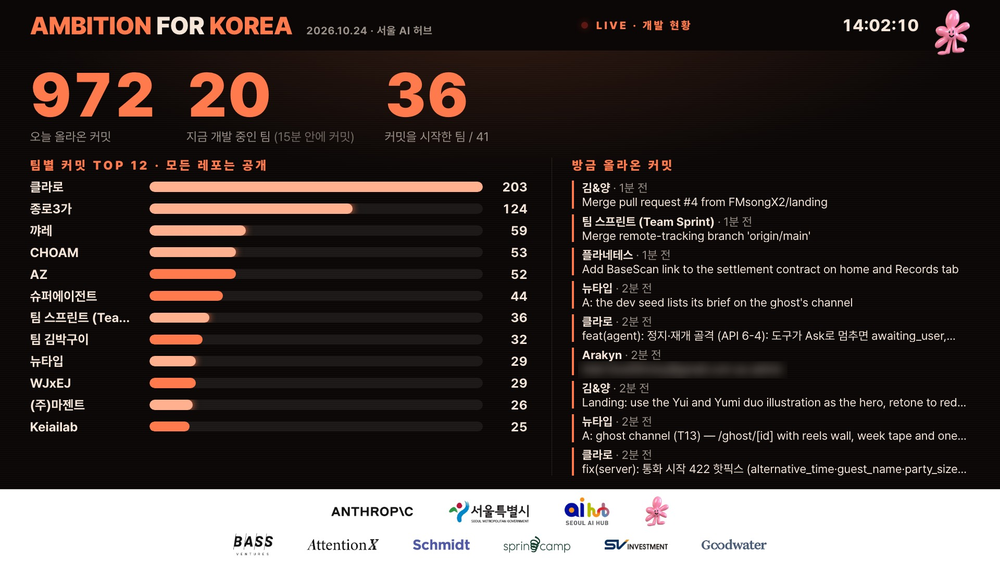 | 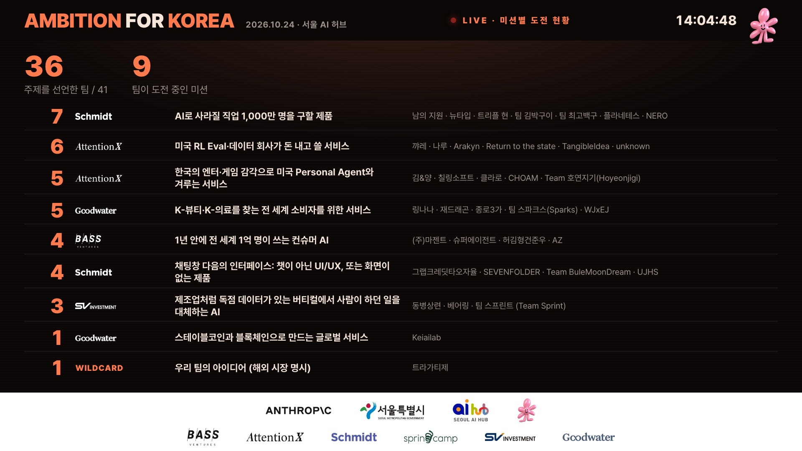 |
| **커밋 화면**: 오늘 커밋 수, 팀별 TOP 12, 방금 올라온 커밋. 레포가 전부 공개라 가능해요 | **미션별 도전 현황**: 어떤 미션에 몇 팀이 도전하는지 |
| 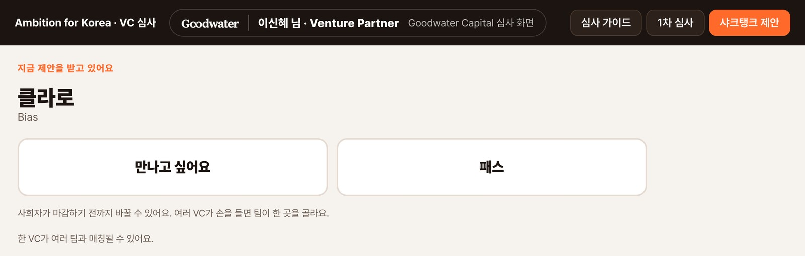 | 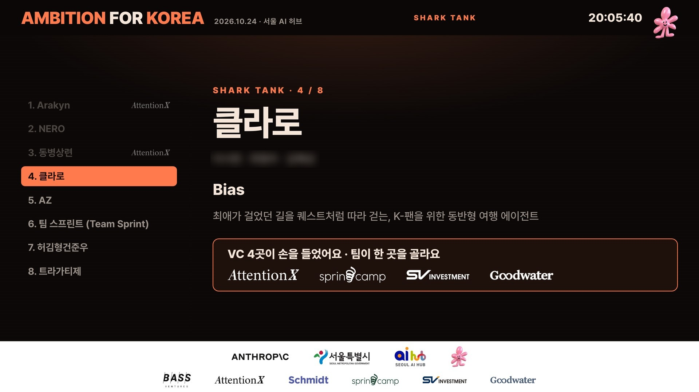 |
| **샤크탱크 제안(VC 화면)**: 질의응답이 끝나면 '만나고 싶어요 / 패스' | **샤크탱크 LED**: 손 든 VC가 한꺼번에, 팀이 한 곳을 골라요 |
| 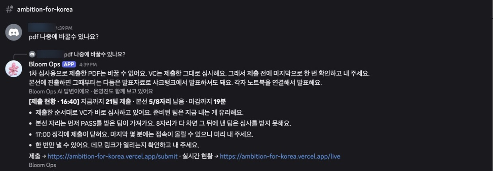 | 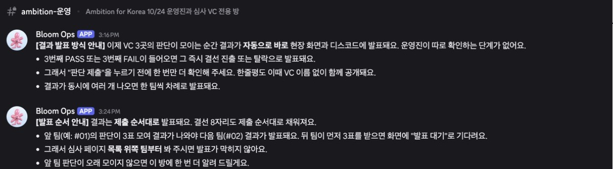 |
| **참가자방**: 질문에 AI가 바로 답하고, 제출 현황이 자동으로 올라가요 | **운영방**: VC에게 가는 자동 공지 (자동 발표 전환, 발표 순서) |

휴대폰용 실시간 현황은 [이렇게](docs/as-run/live-mobile.jpg) 보였어요. 데모 데이터로 띄운 화면은 [docs/screenshots](docs/screenshots)에 있어요.

## AI에게 맡긴 운영

행사 날 운영자 노트북의 Claude Code 세션 하나가 디스코드를 지켰어요. 질문이 올라오면 AI가 "AI 답변이에요 · 운영진도 함께 보고 있어요"라는 표시를 달고 먼저 답했어요. 판단이 필요한 질문은 운영진에게 넘겨 확인을 받은 뒤 같은 글에 이어 달았고요. 제출 알림, 결과 발표, 현황 공지, 백업은 스크립트가 자동으로 했어요.

- 참가자방 봇 게시 205개: 질문 답변 72, 주제 선언 자동 게시 38, 결과 자동 발표 28, 안내·공지 67
- 운영방(VC·운영진) 봇 게시 83개: 제출 알림 36, 샤크탱크 제안 알림 9, 안내·넛지 등
- 행사 중 규칙이 바뀔 때마다 화면과 서버도 그 자리에서 고쳤어요 (글자 수 확대, 자동 발표 전환, 심사 순서, 매칭 방식)

방법과 응대 기준 파일은 [docs/ai-ops.md](docs/ai-ops.md)에 있어요.

## 들어 있는 것

| 화면 | 주소 | 하는 일 |
|---|---|---|
| 참가자 제출 | `/submit` | 주제(미션) 선언과 결과물 제출을 한 링크에서. 신청 이메일로 팀을 찾아요 |
| VC 심사 | `/judge?k=…` | 제출 순서대로 데모·발표자료·커밋 기록을 보고 PASS·FAIL, 한 줄 평과 메모. 샤크탱크 제안 탭 |
| 현장 LED | `/led?key=…` | 오프닝 슬라이드, 실시간 보드(제출 전·심사 중·본선·탈락), 결과 발표 연출, 샤크탱크 |
| 실시간 현황 | `/live` | 휴대폰용 공개 현황 |
| 운영 콘솔 | `/console?key=…` | LED 장면 전환, 마감 시각, 결과 발표, 대리 투표·제출, 샤크탱크 순서·타이머·매칭 |
| 무대 타이머 | `/timer` | 발표 3분, 질의응답 7분 |
| 한 줄 평 아카이브 | `/feedback` | 행사 뒤 VC 한 줄 평을 이름 없이 공개. 결과별·미션별로 보기 |

- `api/`: 서버리스 API (제출, 주제 선언, 투표, 매칭, LED 상태, 커밋 추적, 발표자료 업로드, 관리)
- `ops/`: 디스코드 운영 스크립트 (질문 감시, AI 답변 게시, 결과 자동 발표, 제출 알림, 현황 공지, 백업)
- `docs/`: [규칙](docs/rules.md), [운영 체크리스트](docs/runbook.md), [AI 운영 방식](docs/ai-ops.md), 실제 행사 화면

## 빠르게 띄워 보기

Redis 없이 내 컴퓨터에서 바로 돌아가요. 데이터는 `.data/` 폴더의 파일에 저장돼요.

```bash
npm install
npm run dev
```

다른 터미널에서 데모 데이터를 넣어요. 가짜 팀 14개가 미션을 선언하고 그중 13팀이 제출해요. VC 여섯 곳의 심사와 샤크탱크 매칭까지 들어가요. `--live`를 붙이면 심사가 한창인 오후 상태로 넣어요.

```bash
npm run seed:demo
```

| 화면 | 주소 |
|---|---|
| 현장 LED | http://localhost:4400/led?key=dev-admin |
| 운영 콘솔 | http://localhost:4400/console?key=dev-admin |
| VC 심사 | http://localhost:4400/judge?k=dev-vc1 (`dev-vc1` ~ `dev-vc6`) |
| 참가자 제출 | http://localhost:4400/submit (`dotori@example.com`으로 팀 찾기) |
| 실시간 현황 · 아카이브 · 타이머 | `/live` · `/feedback` · `/timer` |

- `dev-admin`, `dev-vc1` 같은 개발용 키는 내 컴퓨터에서만 통해요. Vercel에 올리면 환경 변수로 넣은 키만 받아요.
- 아카이브 데이터는 `node scripts/build-feedback.mjs`로 다시 만들어요.
- `npm run e2e`는 제출부터 심사까지 한 바퀴 도는 점검이에요.
- 데모 시드는 전체 데이터를 지우고 새로 넣어요. 그래서 내 컴퓨터의 파일 저장소에서만 돌아가요.

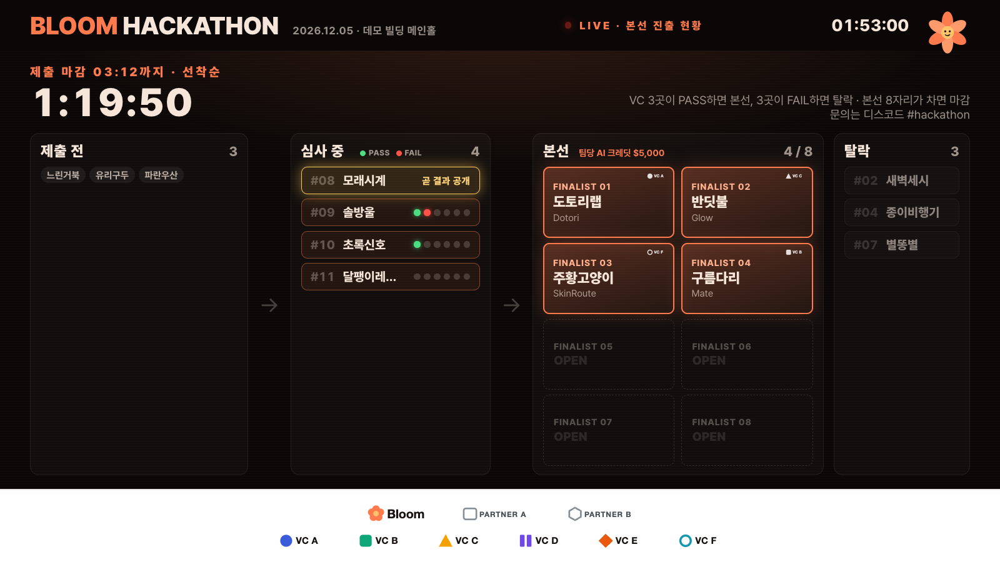

다른 화면은 [docs/screenshots](docs/screenshots)에 있어요.

## 우리 행사로 바꾸기

`public/assets/event.js` 한 파일만 고치면 돼요. 화면과 서버(`api/_lib.js`)가 같은 파일을 읽어요.

- `EVENT`: 행사 이름, 날짜, 장소, 시각(대기·미션 공개·개발 시작·주제 선언 마감·제출 마감·샤크탱크), 본선 자리 수(`capacity`), 결정 표 수(`threshold`), 대량 커밋 기준, 샤크탱크 발표·질의응답 시간, 규칙 문구, 디스코드 링크, 포스터·영상·QR 이미지(없으면 제목 카드로 대신해요)
- `JUDGES`: 심사위원(VC). 키, 이름, 담당자, 직함, 로고
- `MISSIONS`: VC가 낸 미션과 와일드카드. 데모에는 Ambition for Korea의 실제 미션 문구를 그대로 넣어 뒀어요
- `HOSTS`: 주최·파트너 로고

로고는 `public/assets/logos/`에 넣고 경로만 바꾸면 돼요. 마감 시각, 본선 자리, 미션은 당일 운영 콘솔에서도 바꿀 수 있어요. 파일은 시작값이에요.

참가 팀은 신청 시트(팀명·이름·이메일·승인 여부)를 CSV로 받아 `scripts/build-seed.py`로 만들고, `scripts/seed.mjs`로 넣어요. 이메일은 해시로만 저장돼요.

## 배포

1. 버튼을 누르면 내 GitHub에 레포가 복사되고, Vercel 프로젝트와 Redis(Upstash), 발표자료 저장소(Vercel Blob)가 한 번에 만들어져요. 물어보는 건 운영 콘솔 비밀번호(`ADMIN_KEY`) 하나예요. Blob 저장소는 **public**으로 골라 주세요. VC가 발표자료 PDF를 열어야 해서요.
2. 복사된 레포에서 `public/assets/event.js`를 우리 행사에 맞게 고쳐요. GitHub 웹에서 고치고 커밋하면 Vercel이 알아서 다시 배포해요.
3. `/console?key=비밀번호`로 운영 콘솔을 열어요. 도구 칸에 **VC 심사 링크**가 VC마다 하나씩 있어요. 복사해서 VC에게 보내면 끝이에요.

알아 두면 좋은 것:
- Upstash 설치 창에서 플랜과 지역을 골라요. 무료 플랜이 있지만, 이미 무료 Upstash DB를 쓰고 있는 계정에서는 보이지 않을 수 있어요. 그때는 Pay As You Go(10만 명령당 $0.2)를 고르면 돼요. 지역은 Tokyo를 권해요. 이 키트의 서버 함수가 도쿄(hnd1)에서 돌거든요.
- VC 심사 링크와 팀 이메일 확인은 `ADMIN_KEY`로 만들어져요. 행사 중에 비밀번호를 바꾸면 링크도 바뀌니, 바꿔야 한다면 `VC_KEYS`와 `EMAIL_SALT`를 따로 넣어 고정하세요.
- 디스코드 자동 공지(웹훅), GitHub 토큰 같은 선택 항목은 [.env.example](.env.example)에 설명이 있어요.
- Redis 없이 Vercel에 올리면 메모리 저장소로 돌아서 데이터가 남지 않아요. 버튼으로 만들면 Redis가 자동으로 붙어요.
- 화면들이 몇 초마다 상태를 읽어서 행사 당일 Redis 사용량이 크게 늘어요. 그날 하루 만에 무료 플랜의 월 대역폭 한도를 넘겨, 행사가 끝난 밤 데이터베이스가 정지됐어요. 유료 플랜이나 넉넉한 한도로 준비하세요.

## 더 읽을 거리

- [규칙과 당일에 바뀐 것](docs/rules.md)
- [운영 체크리스트](docs/runbook.md): 2주 전부터 행사 뒤까지
- [AI 운영 방식](docs/ai-ops.md)
- 행사 이야기는 [Bloom 블로그](https://blog.bloomworld.ai/)에 정리하고 있어요.

## 라이선스

[MIT](LICENSE). 폰트(Pretendard, Anton, Black Han Sans)는 각 폰트의 SIL Open Font License를 따라요.

만든 곳: [Bloom](https://bloomworld.ai/community/). 이 키트로 해커톤을 열었다면 알려 주세요.

---

## English summary

Bloom Hackathon Kit is the system that ran **Ambition for Korea** (Bloom × Anthropic, Seoul, 24 Oct 2026), a one-day hackathon with live VC judging. 105 builders in 41 teams pushed 2,812 commits, 36 teams submitted, six VCs cast 121 votes, 8 teams reached the shark tank and 5 left with follow-up VC meetings.

How it works: everyone builds from a fresh public repo after 10:00 with the same credits; VCs set the missions; each team submits once; VCs judge in submission order, and the first side to reach 3 votes (PASS or FAIL) decides; the round closes when 8 finalist seats fill; in the shark tank, VCs raise hands and the team picks one.

The kit has the participant submit page, the VC judging page, the LED board, a public live page, the operator console, a stage timer, an anonymous feedback archive, the serverless API (Vercel + Upstash Redis, or a local file store) and the Discord scripts used to run Q&A with Claude Code. See `docs/` for the rules as run, the runbook and the AI ops setup (Korean).
